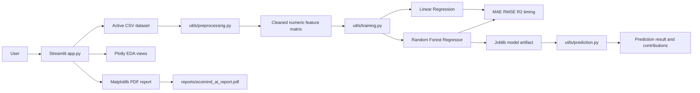
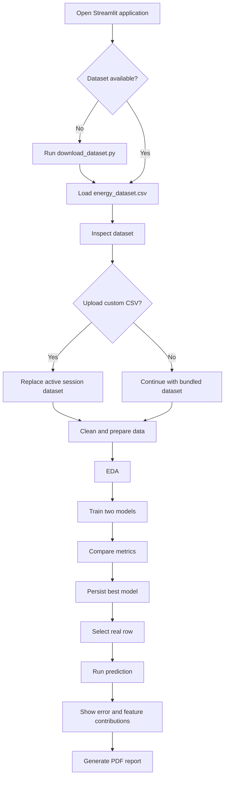

# EcoMind AI
## Smart Building Energy Consumption Prediction Using Machine Learning

**VTU 2022 Scheme Machine Learning Phase-1 Review — Presentation Master Document**

> **Evidence policy:** This document is based on the implemented EcoMind AI project files, verified dataset, executed training pipeline, and tested Streamlit application. Where the implementation does not contain evidence, the document explicitly states that the information is not available rather than inventing it.

---

## 1. Project Title

**EcoMind AI: Smart Building Energy Consumption Prediction Using Machine Learning**

**Tagline:** An interactive machine-learning platform for smart building energy consumption analysis and prediction.

---

## 2. Team Details

| Field | Editable value |
|---|---|
| Team name | _Enter team name_ |
| Student 1 | _Enter name and USN_ |
| Student 2 | _Enter name and USN_ |
| Student 3 | _Enter name and USN_ |
| Student 4 | _Enter name and USN_ |
| Guide | _Enter guide name_ |
| Department | _Enter department_ |
| Institution | _Enter institution_ |
| Academic year | _Enter academic year_ |

Team details are intentionally left editable because they are not present in the implementation.

---

## 3. Problem Statement

Buildings consume energy through appliances, lighting, heating, ventilation and air-conditioning systems. That consumption changes with time, indoor temperature, humidity, outdoor weather and operating conditions. Without a prediction layer, building operators have less visibility into expected demand and fewer opportunities to detect inefficient operating patterns.

EcoMind AI addresses this problem as a **supervised regression task**. It reads real building-energy observations, prepares the data, trains two regression algorithms, evaluates them using held-out data, selects the stronger model, and predicts appliance energy consumption for a selected real observation.

The problem is important because energy consumption is continuous rather than categorical. A building operator needs an estimated energy value, not only a label such as “high” or “low.” Prediction can support energy monitoring, operational planning, anomaly investigation and future demand-management systems.

Potential beneficiaries include building operators, energy managers, facilities teams, sustainability teams, researchers and students learning the complete machine-learning lifecycle.

---

## 4. Objectives

1. Load a real public smart-building energy dataset from `dataset/energy_dataset.csv`.
2. Visually inspect dataset structure, distributions, feature relationships and correlations.
3. Clean duplicates, fill numeric missing values, parse date information and prepare model features.
4. Train and compare Linear Regression and Random Forest Regressor models.
5. Select and persist the stronger model using Joblib.
6. Provide row-level predictions with actual value, predicted value, error, confidence estimate and feature contributions.
7. Allow custom CSV upload, model retraining and downloadable PDF report generation through Streamlit.
8. Explain the ML lifecycle through a responsive dashboard, process terminal and explicit connection-status indicators.

---

## 5. Problem Formulation

### 5.1 Learning problem

The application learns a function that maps building and weather observations to appliance energy consumption:

\[
\hat{y} = f(X)
\]

where `X` contains the input features and `ŷ` is the predicted appliance-energy value.

### 5.2 Regression

Regression predicts a continuous numerical output. In EcoMind AI, the output is the value in the `Appliances` column.

### 5.3 Target variable

The target variable is:

```text
Appliances
```

In the verified source CSV, it is an integer-valued energy-consumption column.

### 5.4 Input features

The source dataset contains the timestamp, lighting load and weather/sensor variables. The implemented preprocessing additionally derives `hour` and `day_of_week` from the timestamp. The full source feature list is documented in Section 7.

### 5.5 Output

For a selected row, the application displays:

- Actual appliance consumption.
- Predicted appliance consumption.
- Absolute prediction error.
- A bounded confidence estimate derived from the relative error.
- Signed feature contributions used for explanation.

### 5.6 Why regression?

Appliance energy consumption is numerical and continuous. Regression preserves the magnitude of the prediction and supports metrics such as MAE, RMSE and R².

### 5.7 Why not classification?

Classification would convert the continuous target into categories such as low, medium and high. That would discard information and require artificial thresholds that are not part of the implemented project. Classification is therefore not appropriate for the current target and workflow.

---

## 6. Dataset Details

| Item | Verified project value |
|---|---|
| Dataset name | Appliances Energy Prediction |
| Dataset source | UCI Machine Learning Repository |
| Download URL | https://archive.ics.uci.edu/static/public/374/appliances+energy+prediction.zip |
| Dataset page | https://archive.ics.uci.edu/dataset/374/appliances+energy+prediction |
| Project location | `dataset/energy_dataset.csv` |
| Rows | 19,735 |
| Columns | 29 |
| Target | `Appliances` |
| Source features | 28 |
| Engineered features | `hour`, `day_of_week` |
| Missing values in verified file | 0 |
| Duplicate rows in verified file | 0 |
| Class distribution | Not applicable; this is regression |
| Source format | CSV |

The verified source file contains 19,735 rows and 29 columns. The 29 source columns include `date`, `Appliances`, `lights` and 26 additional sensor/weather variables. The implemented feature matrix also contains `hour` and `day_of_week`, resulting in 29 numeric model columns including the target after removing the original date column.

The dataset was selected because it directly represents appliance energy consumption in a residential building together with indoor and outdoor environmental measurements. It is publicly available, reproducible and aligned with the smart-building energy-prediction problem.

### Data types

- `date`: string in the source CSV; parsed to datetime during preprocessing.
- `Appliances`: `int64`.
- `lights`: `int64`.
- Sensor and weather columns: `float64`.

### Missing values and duplicates

The verified downloaded CSV contains zero missing cells and zero exact duplicate rows. The application nevertheless implements missing-value filling and duplicate removal so that uploaded custom CSV files follow the same robust preparation path.

---

## 7. Data Dictionary

The project source contains abbreviated UCI feature names. The descriptions below use the meaning represented by the feature names and the UCI dataset context. Units are stated when the implementation or dataset convention makes them explicit; otherwise the unit is marked as **not specified in project code**.

| Feature | Description | Type | Example value | Importance in verified Random Forest |
|---|---|---:|---:|---:|
| `date` | Timestamp of the observation | string → datetime | `2016-01-11 17:00:00` | Used to derive `hour` and `day_of_week` |
| `Appliances` | Appliance energy consumption target | int64 | `60` | Target, not an input |
| `lights` | Lighting energy consumption | int64 | `30` | 0.0317 |
| `T1` | Indoor temperature sensor 1 | float64 | 19.89 | 0.0241 |
| `RH_1` | Indoor relative humidity sensor 1 | float64 | 47.60 | 0.0335 |
| `T2` | Indoor temperature sensor 2 | float64 | 19.19 | 0.0260 |
| `RH_2` | Indoor relative humidity sensor 2 | float64 | 44.79 | 0.0395 |
| `T3` | Indoor temperature sensor 3 | float64 | 19.29 | 0.0617 |
| `RH_3` | Indoor relative humidity sensor 3 | float64 | 44.73 | 0.0431 |
| `T4` | Indoor temperature sensor 4 | float64 | 19.00 | 0.0304 |
| `RH_4` | Indoor relative humidity sensor 4 | float64 | 45.57 | 0.0281 |
| `T5` | Indoor temperature sensor 5 | float64 | 17.17 | 0.0244 |
| `RH_5` | Indoor relative humidity sensor 5 | float64 | 55.20 | 0.0389 |
| `T6` | Indoor/outdoor temperature sensor 6 | float64 | 7.03 | 0.0267 |
| `RH_6` | Relative humidity sensor 6 | float64 | 84.26 | 0.0279 |
| `T7` | Indoor temperature sensor 7 | float64 | 17.20 | 0.0294 |
| `RH_7` | Relative humidity sensor 7 | float64 | 41.63 | 0.0280 |
| `T8` | Indoor temperature sensor 8 | float64 | 18.20 | 0.0364 |
| `RH_8` | Relative humidity sensor 8 | float64 | 48.90 | 0.0275 |
| `T9` | Indoor temperature sensor 9 | float64 | 17.03 | 0.0308 |
| `RH_9` | Relative humidity sensor 9 | float64 | 45.53 | 0.0287 |
| `T_out` | Outdoor temperature | float64 | 6.60 | 0.0272 |
| `Press_mm_hg` | Atmospheric pressure | float64 | 733.50 | 0.0384 |
| `RH_out` | Outdoor relative humidity | float64 | 92.00 | 0.0279 |
| `Windspeed` | Outdoor wind speed | float64 | 7.00 | 0.0258 |
| `Visibility` | Outdoor visibility | float64 | 63.00 | 0.0199 |
| `Tdewpoint` | Outdoor dew point temperature | float64 | 5.30 | 0.0330 |
| `rv1` | Random variable supplied in the source dataset | float64 | source value | 0.0159 |
| `rv2` | Random variable supplied in the source dataset | float64 | source value | 0.0161 |
| `hour` | Hour extracted from `date` | integer | 17 | 0.1695 |
| `day_of_week` | Weekday extracted from `date` | integer | 0 | 0.0096 |

> **Implementation note:** The exact physical sensor placement descriptions beyond the feature names are not encoded in the project source. The project should cite the UCI dataset documentation when presenting detailed sensor definitions.

### Feature-importance ranking

The values below are the verified `feature_importances_` values from the selected Random Forest run.

| Rank | Feature | Importance |
|---:|---|---:|
| 1 | `hour` | 0.1695 |
| 2 | `T3` | 0.0617 |
| 3 | `RH_3` | 0.0431 |
| 4 | `RH_2` | 0.0395 |
| 5 | `RH_5` | 0.0389 |
| 6 | `Press_mm_hg` | 0.0384 |
| 7 | `T8` | 0.0364 |
| 8 | `RH_1` | 0.0335 |
| 9 | `Tdewpoint` | 0.0330 |
| 10 | `lights` | 0.0317 |

The remaining features are available in the Feature Importance page and PDF report.

---

## 8. Exploratory Data Analysis

The implemented EDA page generates three interactive Plotly visualizations.

### 8.1 Energy-consumption histogram

**Purpose:** Show the distribution of the `Appliances` target.

**Observation:** The histogram shows how frequently different energy-consumption values occur.

**Interpretation:** The building has a range of operating loads rather than a single constant energy value.

**Engineering insight:** A model must handle different operating regimes. The distribution supports treating the problem as continuous regression.

**Why it matters:** It helps identify skew, concentration and extreme ranges before training.

### 8.2 Feature-versus-target scatter plot

**Purpose:** Display the relationship between a user-selected numeric feature and `Appliances`.

**Observation:** The user can select a numeric feature and inspect its relationship with the target. The implementation overlays an OLS trendline.

**Interpretation:** A trendline can indicate whether a variable has a simple linear relationship, a weak relationship or a more complex pattern.

**Engineering insight:** A weak individual relationship does not mean a feature is useless. Random Forest can combine several weak or non-linear signals.

**Why it matters:** The chart supports feature screening and helps explain why a non-linear model may outperform a linear baseline.

### 8.3 Correlation heatmap

**Purpose:** Visualize pairwise correlations among numeric variables.

**Observation:** The heatmap displays the correlation matrix for all numeric columns.

**Interpretation:** Strong correlations can reveal related sensor signals and potential redundancy. Correlation does not establish causation.

**Engineering insight:** Correlation is useful for understanding the dataset, but the final model is selected using held-out prediction metrics.

**Why it matters:** It provides a compact view of relationships that are difficult to inspect from a table.

### EDA limitations

The current implementation does not contain an automated written observation engine. The observations above describe what the implemented charts are designed to communicate; exact numeric observations depend on the active dataset and selected feature at runtime.

---

## 9. Data Cleaning

The cleaning implementation is in `utils/preprocessing.py`.

### 9.1 Duplicate removal

`clean_dataframe()` calls `drop_duplicates()` and resets the index. This prevents exact repeated rows from receiving disproportionate influence during training.

The verified bundled dataset contains zero duplicate rows. The cleaning step remains necessary for uploaded custom datasets.

### 9.2 Missing-value handling

Numeric columns are filled using their median. Median imputation is robust to extreme values and preserves all rows. The verified bundled dataset contains zero missing cells, so this branch is primarily defensive for uploaded data.

### 9.3 Date-type correction

Columns named `date`, `datetime` or `timestamp` are parsed with `pd.to_datetime(errors="coerce")`. The date column is then converted into model features and removed from the numeric matrix.

### 9.4 Outlier handling

The current Python implementation does **not** perform winsorization, clipping or explicit outlier removal. Earlier visual concepts mention outlier handling, but the authoritative backend code does not implement it. The presentation must therefore state: **outlier handling is not implemented in the current backend**.

### 9.5 Why cleaning is required

Cleaning protects the model from duplicate evidence, missing numeric values and incompatible date representations. It also allows custom CSV files to follow the same preparation path as the bundled dataset.

---

## 10. Data Preprocessing

The preprocessing sequence is:

1. Load the active CSV with delimiter detection.
2. Remove duplicates.
3. Parse recognized date columns.
4. Median-impute numeric missing values.
5. Extract `hour` and `day_of_week` from the parsed date.
6. Drop the original date column.
7. Select numeric columns.
8. Separate `Appliances` as the target.
9. Split the data into training and test subsets using an 80/20 split with `random_state=42`.

### Encoding

No categorical encoding is used because the implemented source variables are numeric after date processing. The timestamp is not one-hot encoded; it is transformed into numeric time-context features.

### Scaling

No `StandardScaler` or other scaling transformer is used in the current backend. This is valid for the selected tree model and does not prevent Linear Regression from training, although scaling could be evaluated as a future improvement for the linear baseline.

### Normalization

No target normalization or feature normalization is implemented.

### Train-test split

`train_test_split()` uses `test_size=0.2` and `random_state=42`. The test subset is held out during fitting and is used to calculate MAE, RMSE and R².

---

## 11. Feature Engineering

The implementation creates two features from the timestamp:

- `hour`
- `day_of_week`

These features were created because building energy demand often follows a time-of-day and weekday operating rhythm. The source dataset already supplies the environmental and lighting variables, so no unnecessary synthetic or proxy features are generated.

The original `date` string is removed from the numeric feature matrix after extraction.

---

## 12. Machine Learning Models

The project trains exactly two regression algorithms.

### 12.1 Linear Regression

**Purpose:** Baseline model.

**Advantages:** Simple, fast and easy to interpret. It provides a reference point for evaluating whether a more flexible model is useful.

**Disadvantages:** It assumes an approximately linear relationship and may underfit interactions between weather, time and building conditions.

### 12.2 Random Forest Regressor

**Purpose:** Production candidate.

**Implementation configuration:**

- `n_estimators=180`
- `max_depth=18`
- `min_samples_leaf=2`
- `random_state=42`
- `n_jobs=-1`

**Advantages:** Captures non-linear relationships, combines many decision trees, performs well on tabular data and supplies `feature_importances_` for explanation.

**Disadvantages:** Larger model artifact, slower training than Linear Regression, less directly interpretable than a single linear equation, and not a causal model.

### Why Random Forest was selected

The verified run selected Random Forest because it achieved lower MAE and RMSE and higher R² than Linear Regression on the held-out test set. It also provides the feature-importance signal used by the Explainability page and PDF report.

---

## 13. Model Comparison

The following values were extracted from a verified run of `scripts/presentation_facts.py` on the bundled UCI dataset.

| Model | MAE | RMSE | R² score | Training time | Prediction time |
|---|---:|---:|---:|---:|---:|
| Linear Regression | 52.5898 | 91.1363 | 0.1700 | 0.0945 s | 0.0026 s |
| Random Forest Regressor | 33.3240 | 68.7860 | 0.5272 | 7.7348 s | 0.0692 s |

Lower MAE and RMSE are better. Higher R² is better. Random Forest reduces MAE by approximately 36.6% relative to the Linear Regression baseline and provides the strongest verified R² score.

The exact timing can vary by machine, Python version, scikit-learn version and system load. The table above is the captured run used for this document.

---

## 14. Final Model

The final model is the **Random Forest Regressor**.

A Random Forest fits many decision trees on bootstrapped samples and averages their predictions. Each tree creates partitions based on feature values. The ensemble reduces the instability of an individual tree and can represent non-linear interactions.

It performed best because the energy target depends on interacting time, temperature, humidity, lighting and weather signals. The model also supplies feature importance values, which makes the result easier to discuss during a viva.

The selected model is persisted to:

```text
models/energy_prediction_model.pkl
```

The artifact is written by `train_models()` using Joblib and contains the fitted model, feature names, target name and model name. The current Streamlit page retrains the active dataset and updates the in-memory result.

---

## 15. Prediction Process

```text
Active CSV dataset
        ↓
Duplicate removal and numeric median imputation
        ↓
Date parsing
        ↓
Hour and day-of-week feature extraction
        ↓
Numeric feature matrix
        ↓
Trained Random Forest model
        ↓
Selected real row prediction
        ↓
Actual value, predicted value, error, confidence and contributions
```

The user does not manually type arbitrary feature values in the current Streamlit workflow. Instead, the user selects a real row from the active dataset. The row is passed through the same feature-preparation function used by the training code.

The prediction page displays the selected row, actual target, predicted target, absolute error and confidence estimate. The contribution table provides signed feature-level values relative to the stored training baseline. These contributions are explanatory heuristics based on feature values and model importance; they are not causal explanations and are not SHAP values.

---

## 16. Feature Importance

The selected Random Forest ranks `hour` as the strongest feature in the verified run with importance `0.1695`. This indicates that the time-of-day signal contributes strongly to the model’s tree splits.

The next high-ranking features are `T3`, `RH_3`, `RH_2`, `RH_5`, `Press_mm_hg`, `T8`, `RH_1`, `Tdewpoint` and `lights`.

Feature importance answers which variables the fitted model used frequently or effectively for its splits. It does not prove that a feature causes energy consumption. The project should present it as model-based influence, not causal proof.

---

## 17. System Architecture



The frontend dashboard under `client/` is a separate polished visual shell. The authoritative Python ML workflow required by the supplied specification is implemented in `app.py` and the `utils/` modules.

---

## 18. Application Workflow



---

## 19. Folder Structure

```text
EcoMind-AI/
├── app.py
├── presentation_master.md
├── START_HERE.md
├── README.md
├── requirements.txt
├── run_project.sh
├── run_project.bat
├── dataset/
│   └── energy_dataset.csv
├── models/
│   └── energy_prediction_model.pkl
├── reports/
│   └── ecomind_ai_report.pdf
├── scripts/
│   ├── download_dataset.py
│   ├── smoke_test.py
│   └── presentation_facts.py
├── utils/
│   ├── preprocessing.py
│   ├── training.py
│   └── prediction.py
└── client/
    └── src/
        ├── App.tsx
        └── index.css
```

| Path | Purpose |
|---|---|
| `app.py` | Streamlit application and page workflow |
| `dataset/` | Active CSV dataset |
| `models/` | Persisted Joblib model |
| `reports/` | Generated PDF report |
| `utils/preprocessing.py` | Dataset loading, cleaning and feature generation |
| `utils/training.py` | Model fitting, metrics, comparison and persistence |
| `utils/prediction.py` | Row-level prediction and explanation values |
| `scripts/download_dataset.py` | Downloads and normalizes the UCI dataset |
| `scripts/smoke_test.py` | Verifies training and prediction end to end |
| `scripts/presentation_facts.py` | Extracts verified documentation facts |
| `client/` | Visual React dashboard shell created for the interactive preview |

---

## 20. Technologies Used

| Technology | Use in the project | Reason |
|---|---|---|
| Python | Application and ML logic | Required language for the project specification |
| Streamlit | Interactive application | Provides a simple Python-first UI for a demonstrable ML lifecycle |
| Pandas | CSV loading and dataframe operations | Clear tabular data manipulation |
| NumPy | Numerical helper operations | Supports numeric calculations in explanations |
| Scikit-learn | Regression, splitting and metrics | Standard, reproducible ML implementation |
| Joblib | Model persistence | Saves the selected trained model artifact |
| Plotly | Interactive EDA charts | Enables browser-interactive histograms, scatter plots and heatmaps |
| Matplotlib | PDF report figures | Produces static report-ready charts |
| UCI repository | Dataset source | Trusted public academic dataset source |
| React/TypeScript shell | Visual dashboard preview | Provides the polished interface preview; the Streamlit backend remains authoritative for the ML specification |

---

## 21. Challenges Faced

### Dataset delimiter and normalization

The downloaded UCI archive required careful normalization into the project path. The implemented downloader reads the archive CSV and writes a normalized comma-separated file as `dataset/energy_dataset.csv`. The loader also accepts delimiter-detected custom CSV uploads.

### Real-data requirement

The project avoids synthetic sample values. The dataset is downloaded from the UCI repository, stored locally and reused for EDA, cleaning, preprocessing, training and prediction.

### Consistent preprocessing

A row used for prediction must be processed in the same way as training data. The project centralizes this logic in `build_features()` and uses it in both training and prediction paths.

### Model persistence

The selected production model is saved with Joblib. The model artifact is large because it contains 180 Random Forest trees. The project also includes a smoke test and downloader so the artifact can be recreated.

### Explainability limits

The current backend exposes Random Forest feature importance and signed heuristic contributions. It does not implement SHAP, LIME or causal inference. This limitation must be stated during review.

### Generated report

The report engine generates pages in memory with Matplotlib and returns a downloadable PDF containing a summary, EDA charts, feature importance and prediction trace.

### Project packaging

The complete ZIP includes generated dataset and model artifacts. Repository checkpoint systems may reject large binary artifacts, but the downloadable package is self-contained.

---

## 22. Future Scope

1. Add temporal train-test splitting so future observations are evaluated against past observations.
2. Add cross-validation and confidence intervals for more robust evaluation.
3. Add SHAP-based explanations with per-row waterfall plots.
4. Add explicit outlier detection and a documented policy for sensor spikes.
5. Add model versioning and prediction history.
6. Add authentication and role-based access for building teams.
7. Add scheduled ingestion from building-management-system sensors.
8. Add drift detection when the live data distribution changes.
9. Add energy-cost and carbon-emission estimates using configurable tariffs and emission factors.
10. Add a deployment configuration for a Python-capable hosting service.
11. Add a time-series model comparison after the baseline regression workflow is approved.

These are future improvements. They are not implemented in the current project.

---

## 23. Conclusion

EcoMind AI demonstrates a complete, inspectable machine-learning lifecycle for smart-building energy prediction. It uses one real UCI dataset, cleans and transforms the data, trains two regression models, evaluates them on held-out data, persists the selected Random Forest model, performs live row-level prediction and generates a report.

The verified run selected Random Forest with MAE `33.3240`, RMSE `68.7860` and R² `0.5272`. The project does not present the model as a black box: its feature-importance page, prediction explanation table, process terminal and report workflow show how data moves through the system.

The main current limitations are the modest verified R² score, the lack of explicit outlier handling, the absence of scaling, and the heuristic rather than causal nature of prediction contributions. These limitations are visible and provide clear scope for future work.

---

## 24. Viva Preparation

### Dataset and problem formulation

1. **What is the project title?**  
   EcoMind AI: Smart Building Energy Consumption Prediction Using Machine Learning.

2. **What is the problem type?**  
   Supervised regression.

3. **What is the target variable?**  
   `Appliances`.

4. **Why is the target suitable for regression?**  
   It is a continuous numeric energy-consumption value.

5. **Which dataset is used?**  
   The UCI Appliances Energy Prediction dataset.

6. **How many rows are in the verified dataset?**  
   19,735 rows.

7. **How many source columns are present?**  
   29 columns.

8. **What is the source URL?**  
   The UCI Machine Learning Repository download URL documented in Section 6.

9. **Why was this dataset selected?**  
   It contains appliance energy consumption together with indoor and outdoor sensor measurements relevant to smart buildings.

10. **Is this classification?**  
    No. The output is a numerical energy value, so it is regression.

### EDA

11. **Why use a histogram?**  
    To inspect the target distribution and operating-load range.

12. **Why use a scatter plot?**  
    To inspect the relationship between a selected feature and energy consumption.

13. **What does the OLS trendline show?**  
    It provides a simple visual summary of the selected feature-target relationship.

14. **Why use a correlation heatmap?**  
    To inspect pairwise linear relationships among numeric columns.

15. **Does correlation prove causation?**  
    No. It measures association, not causal effect.

16. **Why are charts generated dynamically?**  
    They respond to the active dataset and selected feature.

17. **Does the current backend generate an automated written EDA narrative?**  
    No. It generates the charts; interpretation is presented in the UI/documentation.

### Cleaning and preprocessing

18. **How are duplicates handled?**  
    Exact duplicate rows are removed with `drop_duplicates()`.

19. **How are numeric missing values handled?**  
    They are filled with the column median.

20. **Does the bundled dataset contain missing values?**  
    No; the verified file contains zero missing cells.

21. **Does the bundled dataset contain duplicates?**  
    No; the verified file contains zero exact duplicate rows.

22. **How is the date column handled?**  
    It is parsed and used to derive `hour` and `day_of_week`, then removed from the numeric matrix.

23. **Is one-hot encoding used?**  
    No categorical features are present after preprocessing.

24. **Is feature scaling used?**  
    No. The current implementation does not use `StandardScaler` or normalization.

25. **Is outlier removal implemented?**  
    No. The current backend does not implement explicit outlier handling.

26. **What is the train-test split?**  
    80% training and 20% testing with `random_state=42`.

27. **Why use a fixed random state?**  
    To make the split and results more reproducible.

28. **Why is the same preprocessing used for prediction?**  
    To prevent training-serving inconsistencies.

### Regression and models

29. **Which models are trained?**  
    Linear Regression and Random Forest Regressor.

30. **Why train Linear Regression?**  
    It is a simple baseline for comparison.

31. **Why train Random Forest?**  
    It can model non-linear tabular relationships and provides feature importance.

32. **What is an ensemble?**  
    A model that combines predictions from multiple constituent models.

33. **How does Random Forest work?**  
    It trains multiple decision trees and aggregates their predictions.

34. **What is `n_estimators`?**  
    The number of trees in the forest; the project uses 180.

35. **What is `max_depth`?**  
    The maximum tree depth; the project sets it to 18.

36. **What is `min_samples_leaf`?**  
    The minimum samples allowed in a leaf; the project sets it to 2.

37. **Why might Linear Regression underperform?**  
    The building-energy relationship may contain interactions and non-linear patterns.

38. **Which model was selected?**  
    Random Forest Regressor.

### Evaluation

39. **What is MAE?**  
    Mean Absolute Error, the average absolute difference between actual and predicted values.

40. **What is RMSE?**  
    Root Mean Squared Error, which penalizes larger errors more strongly than MAE.

41. **What is R²?**  
    A coefficient describing how much target variance is explained relative to a mean baseline.

42. **Which model had the lower MAE?**  
    Random Forest: 33.3240 versus Linear Regression: 52.5898.

43. **Which model had the lower RMSE?**  
    Random Forest: 68.7860 versus Linear Regression: 91.1363.

44. **Which model had the higher R²?**  
    Random Forest: 0.5272 versus Linear Regression: 0.1700.

45. **What does the R² value mean here?**  
    The verified Random Forest explains approximately 52.72% of target variance under this split and configuration.

46. **Is the R² perfect?**  
    No. It leaves substantial unexplained variation and should not be overstated.

47. **Why is held-out evaluation needed?**  
    To estimate performance on data not used for fitting.

48. **Can timing values vary?**  
    Yes. Timing depends on hardware, environment and system load.

### Prediction and explainability

49. **How does the user select an input?**  
    By selecting a real row from the active dataset.

50. **What does the prediction page display?**  
    Actual value, predicted value, absolute error, confidence and signed contributions.

51. **How is confidence calculated?**  
    It is a bounded heuristic based on relative prediction error, not a calibrated probability.

52. **What is feature importance?**  
    A model-derived measure of how useful features were for Random Forest splits.

53. **Which feature ranked highest?**  
    `hour`, with verified importance approximately 0.1695.

54. **Does feature importance prove causality?**  
    No.

55. **Are the signed contributions SHAP values?**  
    No. They are heuristic values using feature deviation, importance weighting and a training baseline.

56. **Why show contributions?**  
    To provide a transparent directional explanation for the selected prediction.

57. **What happens if a custom CSV lacks `Appliances`?**  
    Training raises a validation error because the target is required.

58. **What happens after CSV upload?**  
    The active in-memory dataset is replaced and previous training/prediction state is cleared.

### Streamlit and architecture

59. **Why Streamlit?**  
    It allows the complete Python ML pipeline to be demonstrated through an interactive interface.

60. **How is the model persisted?**  
    Joblib writes it to `models/energy_prediction_model.pkl`.

61. **Where is the report created?**  
    The report is generated in memory and also written to `reports/ecomind_ai_report.pdf`.

62. **What does Dataset reader CONNECTED mean?**  
    The active CSV has been loaded into the current Streamlit session.

63. **What does Model runtime READY mean?**  
    A trained in-memory result or persisted model is available.

64. **What does live mean in this project?**  
    The current Streamlit session performs file reading, preprocessing, training, prediction and report generation interactively. It is not a 24/7 sensor telemetry service.

65. **What is the role of Plotly?**  
    It creates interactive EDA visualizations.

66. **What is the role of Matplotlib?**  
    It creates static figures for the PDF report.

### Future and general ML concepts

67. **What is overfitting?**  
    Learning training-specific patterns that do not generalize to unseen data.

68. **What is underfitting?**  
    A model that is too simple to capture the relevant pattern.

69. **What is data leakage?**  
    Using information during training that would not be available when making the prediction.

70. **How can this project be improved for time series?**  
    Use chronological splits and evaluate future periods against past periods.

71. **Why could cross-validation help?**  
    It provides performance estimates across multiple partitions.

72. **What is model drift?**  
    A change in the data or relationship that reduces deployed-model performance.

73. **What is a limitation of the current dataset split?**  
    The split is random rather than explicitly chronological.

74. **What is a limitation of the current explanation?**  
    Contributions are heuristic rather than causal or SHAP-based.

75. **What is the most important future deployment step?**  
    Add model versioning, monitoring and persistent prediction history.

---

## 25. Presentation Script

The following script is designed for approximately 20 minutes and four team members. Team names remain editable.

### Member 1 — Slides 1–4, approximately 5 minutes

**Slide 1 — Title:**

“Good morning. Our project is EcoMind AI, a smart-building energy consumption prediction platform using machine learning. The system is designed to make the complete ML lifecycle visible, from loading real data to explaining a prediction.”

**Slide 2 — Problem statement:**

“Building energy usage changes with time, lighting, temperature, humidity and outdoor conditions. A facility operator needs an estimated consumption value rather than only a broad category. Our project formulates this as a regression problem using real building-energy observations.”

**Slide 3 — Objectives:**

“Our objectives are to inspect a trusted real dataset, clean and prepare it, train two regression models, compare them using standard metrics, persist the selected model, perform row-level predictions and generate an explanatory report.”

**Slide 4 — Problem formulation:**

“The target is the Appliances column. The input contains lighting, temperature, humidity and weather variables. Because the output is continuous energy consumption, regression is appropriate. Classification would require artificial bins and would lose the numerical magnitude.”

**Likely questions:** Why regression? Why this dataset? Why not classify energy as low or high?

### Member 2 — Slides 5–9, approximately 5 minutes

**Slide 5 — Dataset:**

“We use the UCI Appliances Energy Prediction dataset. The verified file has 19,735 rows and 29 columns. It is stored in dataset/energy_dataset.csv and is reused throughout the complete pipeline.”

**Slide 6 — Data dictionary:**

“The source contains a timestamp, lighting consumption, appliance consumption and sensor/weather variables. The project parses the date into hour and day-of-week features. The exact source fields and their verified types are listed in the data dictionary.”

**Slide 7 — EDA:**

“The EDA page generates a target histogram, a selectable feature-target scatter plot with an OLS trendline, and a numeric correlation heatmap. These views help us understand distribution, relationships and possible redundancy.”

**Slide 8 — Cleaning:**

“The cleaning function removes exact duplicate rows, fills numeric missing values with medians and parses recognized date columns. The bundled dataset currently has zero missing cells and zero duplicates, but the same logic supports uploaded CSV files.”

**Slide 9 — Preprocessing:**

“After cleaning, the date becomes hour and day-of-week. The original date string is removed, numeric columns are selected, and the data is split into 80% training and 20% testing with a fixed seed.”

**Likely questions:** What is median imputation? What is data leakage? Why parse the timestamp?

### Member 3 — Slides 10–14, approximately 5 minutes

**Slide 10 — Models:**

“We train two models only. Linear Regression is the baseline. Random Forest is the production candidate because it can represent non-linear relationships and supplies feature importance.”

**Slide 11 — Model comparison:**

“On the verified run, Linear Regression achieved MAE 52.5898, RMSE 91.1363 and R² 0.1700. Random Forest achieved MAE 33.3240, RMSE 68.7860 and R² 0.5272. Lower errors and higher R² make Random Forest the selected model.”

**Slide 12 — Final model:**

“Random Forest uses 180 trees, maximum depth 18, minimum leaf size 2 and a fixed random state. After comparison, the selected model is persisted with Joblib.”

**Slide 13 — Prediction:**

“The user selects a real row instead of manually typing arbitrary values. The row passes through the same preprocessing path and the model returns a predicted energy value. The interface displays actual value, prediction, error and a confidence estimate.”

**Slide 14 — Explainability:**

“The top verified feature is hour, followed by T3 and humidity-related variables. The project also shows signed heuristic contributions. These are explanatory values, not causal effects or SHAP values.”

**Likely questions:** Why Random Forest? What is R²? Are contributions causal? How is confidence calculated?

### Member 4 — Slides 15–18, approximately 5 minutes

**Slide 15 — System architecture:**

“The Streamlit app coordinates the workflow. Preprocessing creates the feature matrix. Training fits both regressors and calculates metrics. The selected model is persisted. Prediction utilities score a selected row, while Plotly and Matplotlib support visualization and reporting.”

**Slide 16 — Live application:**

“The sidebar explicitly shows dataset, model and report-engine status. The process terminal shows actions such as loading, cleaning, feature construction, training and prediction. This makes it clear what is connected and what is currently running.”

**Slide 17 — PDF report and upload:**

“The user can upload a custom CSV, retrain on the active data and generate a PDF containing the summary, EDA charts, feature importance and prediction trace. The uploaded data must contain the Appliances target column for training.”

**Slide 18 — Conclusion and future scope:**

“EcoMind AI demonstrates a complete and inspectable regression workflow using real data. Important future improvements include chronological validation, cross-validation, SHAP explanations, explicit outlier policy, model monitoring and prediction history.”

**Closing:**

“Our project is designed not only to produce a prediction but also to show how the prediction was produced. Thank you. We are ready for questions.”

**Likely questions:** How do you run it? What does live mean? What are the limitations? How would you deploy it?

---

## 26. PPT Mapping

The project brief requests a Phase-1 presentation but does not specify an exact slide limit. The following 18-slide mapping is a practical proposal.

| Slide | Title | Content | Images required | Graphs required | Presenter | Time |
|---:|---|---|---|---|---|---:|
| 1 | EcoMind AI | Title, team and guide placeholders | Home screen | None | Member 1 | 0:45 |
| 2 | Problem statement | Building energy problem | Building/energy visual if available | None | Member 1 | 1:00 |
| 3 | Objectives | Six project objectives | ML lifecycle icon | None | Member 1 | 1:00 |
| 4 | Problem formulation | Regression, target, inputs, output | Pipeline graphic | None | Member 1 | 2:15 |
| 5 | Dataset | UCI source and size | Dataset page screenshot | None | Member 2 | 1:15 |
| 6 | Data dictionary | Sensors, weather, lighting and target | Schema screenshot | None | Member 2 | 1:15 |
| 7 | EDA | Distribution and relationships | EDA page screenshot | Histogram | Member 2 | 1:30 |
| 8 | Correlation analysis | Numeric relationships | Heatmap screenshot | Correlation heatmap | Member 2 | 1:00 |
| 9 | Cleaning | Duplicates, missing values and parsing | Cleaning page screenshot | Before/after metrics | Member 2 | 1:00 |
| 10 | Preprocessing | Feature extraction and split | Preprocessing screenshot | Workflow diagram | Member 3 | 1:00 |
| 11 | Algorithms | Linear Regression and Random Forest | Model page screenshot | None | Member 3 | 1:00 |
| 12 | Model comparison | Metrics and selection | Model table screenshot | Metric comparison | Member 3 | 1:30 |
| 13 | Final model | Random Forest configuration | Model artifact screenshot if desired | None | Member 3 | 1:00 |
| 14 | Live prediction | Row selection and result | Prediction page screenshot | Prediction result | Member 3 | 1:30 |
| 15 | Explainability | Feature importance and contributions | Feature page screenshot | Importance bar chart | Member 4 | 1:15 |
| 16 | Architecture | Data and application flow | Mermaid rendered diagram | None | Member 4 | 1:00 |
| 17 | Report and future scope | PDF, upload and improvements | Report page screenshot | None | Member 4 | 1:00 |
| 18 | Conclusion | Findings and limitations | Final dashboard screenshot | None | Member 4 | 0:45 |

The diagrams and screenshots listed here should be generated from the actual application. No screenshot files are currently stored in the project, so they must be captured during presentation preparation.

---

## 27. Screenshots

| Screenshot | Page | Action | Why include it |
|---:|---|---|---|
| 1 | Overview | Open the application and show the lifecycle cards | Establishes the complete product scope |
| 2 | Overview | Show the live process terminal | Demonstrates visible runtime activity |
| 3 | Dataset & Upload | Open the default dataset view | Proves the real CSV is loaded |
| 4 | Dataset & Upload | Expand schema and summary statistics | Shows columns, types and descriptive statistics |
| 5 | Dataset & Upload | Upload a custom CSV | Demonstrates the custom-data capability |
| 6 | EDA Studio | Show the target histogram | Explains distribution |
| 7 | EDA Studio | Select a feature and show scatter plot | Explains feature-target relationship |
| 8 | EDA Studio | Show correlation heatmap | Explains numeric relationships |
| 9 | Cleaning | Display before and after metrics | Explains cleaning behavior |
| 10 | Preprocessing | Show terminal trace | Makes the pipeline visible |
| 11 | Model Lab | Click train/retrain and capture completed results | Proves both models were executed |
| 12 | Model Lab | Capture comparison table | Shows MAE, RMSE and R² selection evidence |
| 13 | Live Prediction | Select a real row before prediction | Shows the input is not fabricated |
| 14 | Live Prediction | Run prediction and capture result | Shows actual, predicted, error and confidence |
| 15 | Live Prediction | Show contribution table | Explains how the row was interpreted |
| 16 | Feature Importance | Capture ranked importance chart | Supports explainability |
| 17 | Report | Generate the PDF | Proves report functionality |
| 18 | Light mode | Toggle the dashboard theme | Demonstrates UI/UX completeness |
| 19 | Mobile dashboard | Capture responsive view | Demonstrates responsive design |

The current project does not include captured screenshot image files. These are capture instructions for preparing the PPT.

---

## 28. References

1. UCI Machine Learning Repository, Appliances Energy Prediction dataset. [1]
2. Scikit-learn documentation for `RandomForestRegressor`, regression metrics and train-test splitting. [2]
3. Streamlit documentation for applications, file upload and download widgets. [3]
4. Pandas documentation for CSV loading and dataframe operations. [4]
5. Plotly Python documentation for interactive charts. [5]
6. Joblib documentation for model persistence. [6]
7. Matplotlib documentation for static figures and PDF output. [7]

---

## Appendix A — Exact Run Commands

```bash
cd ecomind-ai

python -m venv .venv
source .venv/bin/activate
pip install -r requirements.txt
python scripts/download_dataset.py
streamlit run app.py
```

On Windows PowerShell:

```powershell
cd ecomind-ai
python -m venv .venv
.venv\Scripts\Activate.ps1
pip install -r requirements.txt
python scripts/download_dataset.py
streamlit run app.py
```

The included launchers are:

```text
run_project.sh
run_project.bat
```

The app runs locally at `http://localhost:8501` by default.

---

## Appendix B — Evidence and Limitations Checklist

| Requirement | Evidence in implementation | Status |
|---|---|---|
| Real public dataset | UCI downloader and normalized CSV | Implemented |
| Single dataset path | `dataset/energy_dataset.csv` | Implemented |
| EDA | Plotly histogram, scatter and heatmap | Implemented |
| Cleaning | Duplicate removal, median imputation, date parsing | Implemented |
| Outlier handling | No backend implementation | Not implemented |
| Encoding | No categorical encoding needed | Not required by current data |
| Scaling | No scaler in backend | Not implemented |
| Feature engineering | `hour`, `day_of_week` | Implemented |
| Linear Regression | Trained and evaluated | Implemented |
| Random Forest | Trained, evaluated and persisted | Implemented |
| Model comparison | MAE, RMSE, R² and timing | Implemented |
| Live prediction | Selected active-data row | Implemented |
| Confidence | Relative-error heuristic | Implemented, not calibrated |
| Feature importance | Random Forest importance | Implemented |
| SHAP/LIME | Not present | Not implemented |
| CSV upload | Delimiter-tolerant file uploader | Implemented |
| Retraining | Trains active dataset | Implemented |
| PDF report | EDA, importance and prediction pages | Implemented |
| Authentication | No authentication layer | Not implemented |
| Persistent prediction history | No database/history layer | Not implemented |
| Team details | Not in source files | Editable placeholders |
| Screenshots | Not stored in project | Capture during PPT preparation |

---

## References

[1]: https://archive.ics.uci.edu/dataset/374/appliances+energy+prediction "UCI Appliances Energy Prediction dataset"
[2]: https://scikit-learn.org/stable/ "Scikit-learn documentation"
[3]: https://docs.streamlit.io/ "Streamlit documentation"
[4]: https://pandas.pydata.org/docs/ "Pandas documentation"
[5]: https://plotly.com/python/ "Plotly Python documentation"
[6]: https://joblib.readthedocs.io/en/latest/ "Joblib documentation"
[7]: https://matplotlib.org/stable/ "Matplotlib documentation"
